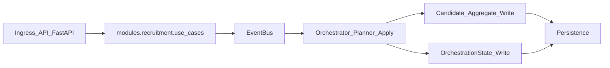
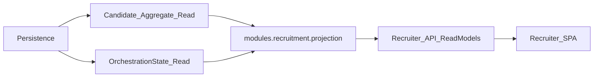
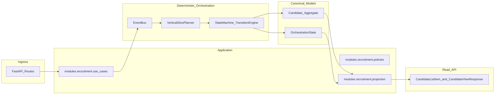

# Architecture (Baseline + Actual Map)

Purpose: provide a **single, durable** architecture baseline for this repo so future rounds do not drift into “demo-first” shortcuts or parallel canonical models.

This doc has three layers:

1. **Actual (as-is) architecture map**: how code is wired today.
2. **Baseline read/write diagrams**: the explicit system flow constraints for R-008+.
3. **Target direction**: how the system should evolve as Candidate aggregate semantics become canonical.

---

## 1) Actual (as-is) architecture map (today)

### Core dependency direction (module boundaries)

From [`docs/architecture/ADR.md`](../architecture/ADR.md) ADR-008:

- `integrations/api` → `modules/recruitment` → `runtime` / `orchestrator` / store
- HTTP stays thin; policy and read projections live in `modules/recruitment`

### Actual data path: write vs read

**Write path (today):**

- Ingress hits FastAPI routes in `integrations/api/app.py`
- Routes call `modules/recruitment/use_cases.py`
- Use cases publish envelopes into the event bus and run orchestrator planning/apply
- Persisted state of record for the recruiter surface is primarily the **orchestration snapshot** (`schemas/state_schema.py::OrchestrationState`) stored in SQLite / in-memory store

**Read path (today):**

- Recruiter endpoints read latest `OrchestrationState` snapshot from store
- `modules/recruitment/projection.py` builds recruiter-facing dicts
- `integrations/api/schemas_http.py` validates/serializes response bodies
- Frontend consumes those endpoints

### Key code entrypoints

- **FastAPI boundary**: `integrations/api/app.py`
- **Use cases**: `modules/recruitment/use_cases.py`
- **Read-model projection**: `modules/recruitment/projection.py`
- **Planner/orchestrator**: `orchestrator/vertical_slice_planner.py`, `orchestrator/orchestrator.py`
- **Persistence**: `runtime/persistence/sqlite_state_store.py`
- **Schemas**:
  - Workflow snapshot: `schemas/state_schema.py`
  - Candidate aggregate (mostly not consumed today): `schemas/candidate_schema.py`

---

## 2) Baseline diagrams (R-008+ constraint)

These diagrams are the **normative baseline** for future rounds.

### 2.1 Write path event-flow baseline



### 2.2 Read path read-model baseline



### 2.3 Ownership matrix baseline (high level)

- **`Candidate` aggregate** owns: identity + profile business data.
- **`OrchestrationState`** owns: workflow state (phase/decision), evaluation state, flags, transitions.
- **`projection.py`** is the *single* read-model assembly boundary for recruiter API output.
- **Routes** in `integrations/api` must not assemble read models directly; they call use cases / projections.

---

## 3) Target direction (ideal architecture diagram)

This merges the baseline into a single “ideal” flow chart.



---

## 4) “Actual classes” inventory (how to generate)

You asked for a full inventory of classes across the repo to find misalignment/redundancy. That list is large and should be generated mechanically to avoid staleness.

Recommended command (run from repo root):

```bash
python -c "import ast, pathlib; root=pathlib.Path('.');\nfor p in sorted(root.rglob('*.py')):\n  if any(x in str(p) for x in ['/.venv/','/node_modules/','/dist/','/__pycache__/']):\n    continue\n  try: t=ast.parse(p.read_text(encoding='utf-8'))\n  except Exception: continue\n  classes=[n.name for n in t.body if isinstance(n, ast.ClassDef)]\n  if classes:\n    print(str(p).replace('\\\\','/'))\n    for c in classes: print('  -', c)\n\"\n```

For reviewability, keep the generated output **out of version control** unless we intentionally snapshot it for an architecture audit round.

---

## 5) Known misalignments (current issues to fix)

These are the specific mismatches that prompted R-008:

- `schemas/candidate_schema.py` defines a rich `Candidate` aggregate but it is largely not consumed by current runtime (state-first reality).
- Recruiter API `CandidateViewResponse.profile` is currently `Dict[str, Any]` and thus contract-loose; frontend assumptions drift easily.
- Summary fallback placeholder text in projection layer can leak demo-era copy.

